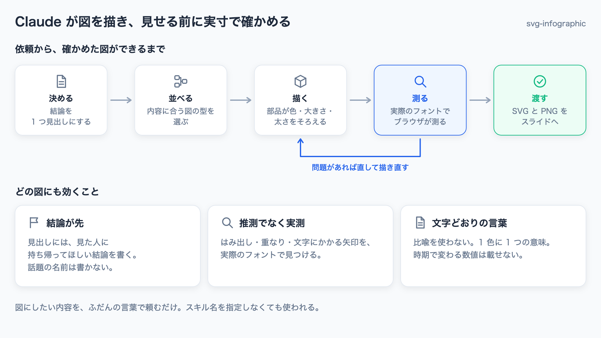
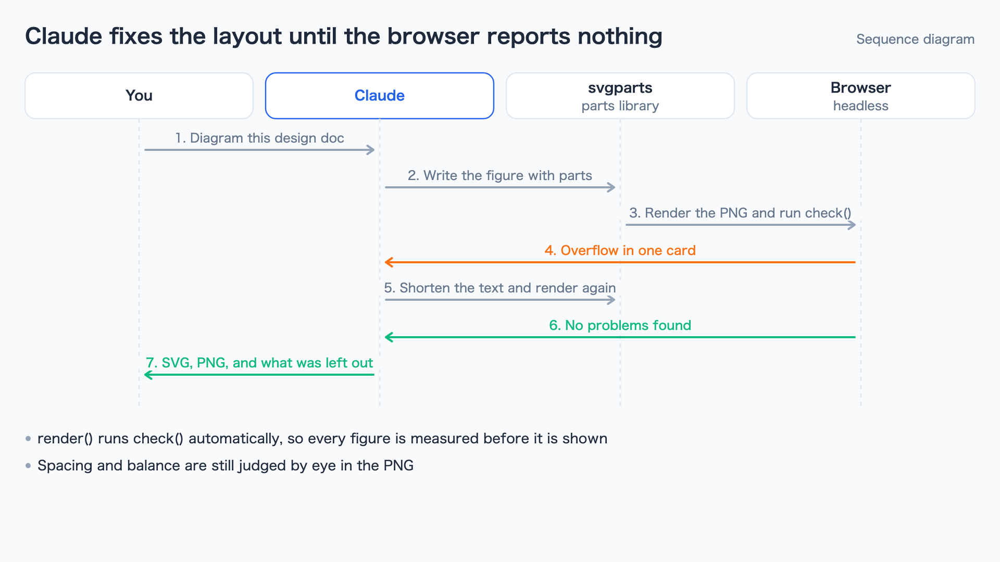
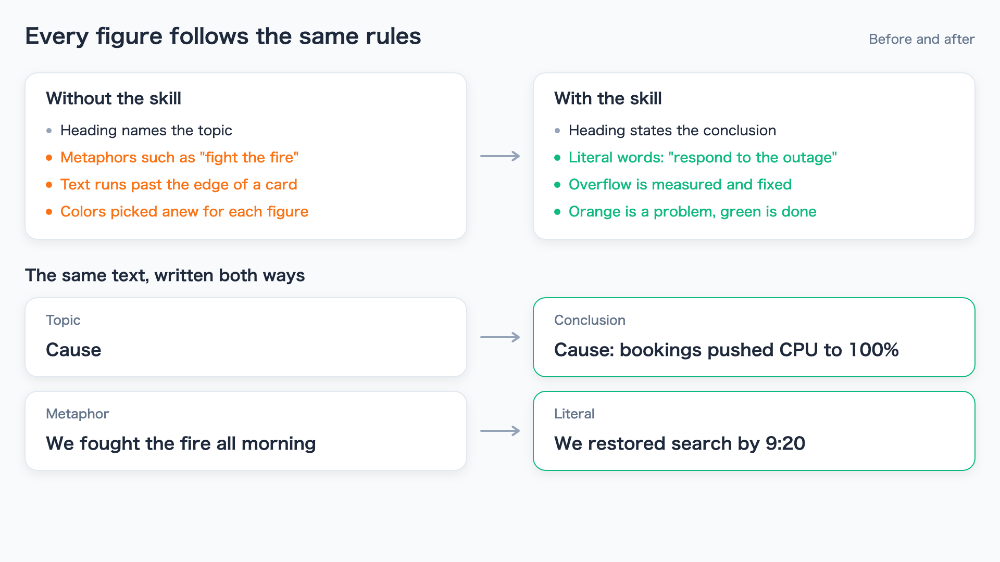
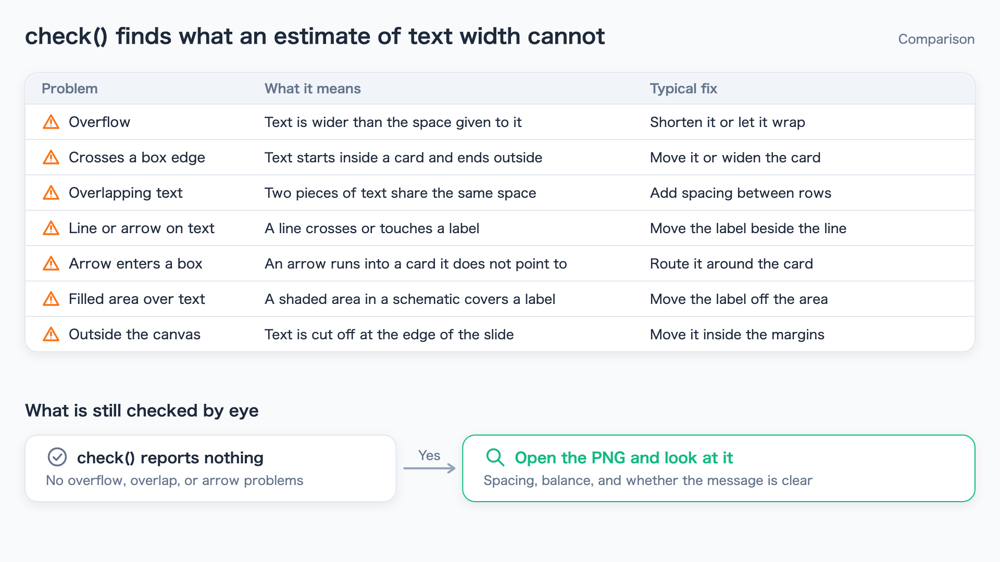
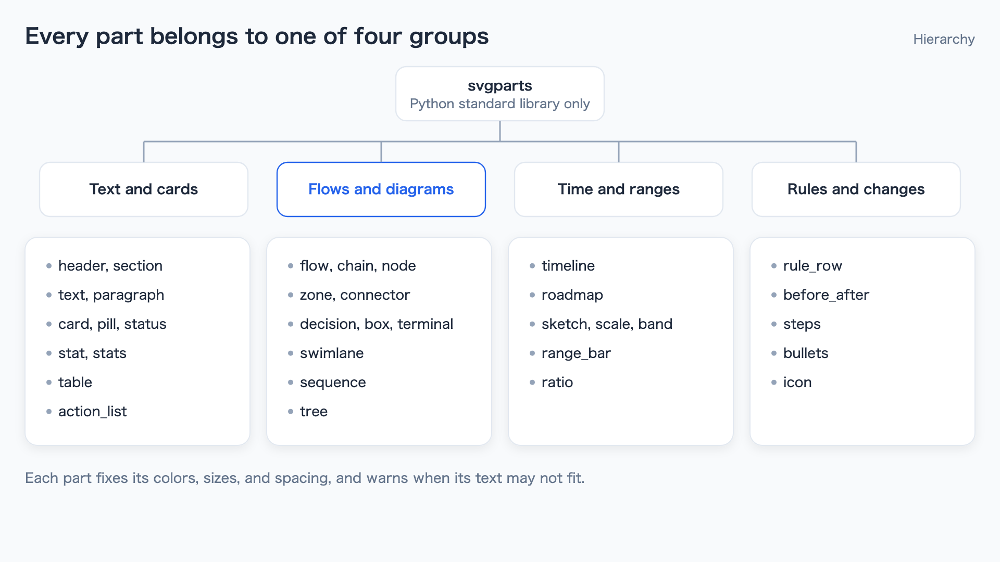

# svg-infographic

[English](README.md)

業務のインフォグラフィックを、スライドにそのまま貼れる 1 枚の SVG で描く [Claude Code](https://docs.claude.com/en/docs/claude-code) のスキルです。Claude が伝えることを決め、部品集で図を描き、実際のフォントでヘッドレスブラウザに測らせて問題を直してから、SVG と PNG を渡します。



この README の画像は、すべてこのスキルで描いています。描くスクリプトは [examples/gen_examples.py](examples/gen_examples.py) です。

## 導入

Claude Code で次の 2 つを実行します。

```
/plugin marketplace add usuginus/svg-infographic
/plugin install svg-infographic@svg-infographic
```

あとは、図にしたい内容をふだんの言葉で頼むだけです。スキル名を指定しなくても使われます。

- 「この設計書の処理の流れを図解して」
- 「3 つの案の比較を、スライドに貼れる図にして」
- 「障害の経緯と再発防止策を、1 枚のインフォグラフィックにまとめて」

図の文字は、頼んだときの言語で書かれます。

## 特徴

- **結論が先**: 見出しには、話題の名前ではなく、見た人に持ち帰ってほしい結論を書きます。1 枚で伝えることは 1 つです。
- **推測でなく実測**: 描いた後に SVG をヘッドレスブラウザで開いて測ります。はみ出し、カードの端をまたぐ文字、文字の重なり、文字にかかる線や矢印、カードに入り込む矢印、文字にかかる塗りを見つけて直します。
- **文字どおりの言葉**: 比喩を使わず、1 色に 1 つの意味を持たせ、時期によって変わる数値は載せません。
- **日本語の折り返し**: 説明を 1 つの文字列で渡せば、幅に合わせて折り返します。句読点や助詞の後で折り、カタカナの語や英数字の途中では切らず、行頭に「、」「。」「」」や助詞を置きません。
- **配色の差し替え**: `{"PRIMARY": "#7C3AED"}` のように色の役割ごとに指定すると、すべての部品が従います。

## ギャラリー

ギャラリーの画像は英語版と共通です。

| | |
|---|---|
|  |  |
| **シーケンス図**: あなた・Claude・部品集・ブラウザの間で、問題が無くなるまで直す流れ | **変更前後**: スキルの規則に従うと、図の何が変わるか |
|  |  |
| **表と条件の行**: ブラウザでの確認が見つける問題と、目で見て確かめること | **階層図**: 部品集の部品を、描くものごとに 4 つに分けたもの |

部品の一覧と使い分けは [SKILL.md](plugins/svg-infographic/skills/svg-infographic/SKILL.md#parts-library-scriptssvgpartspy) にあります（英語）。

## 部品集を直接使う

部品集はスキルを使わずにも使えます。

```python
import sys
sys.path.insert(0, "plugins/svg-infographic/skills/svg-infographic/scripts")
from svgparts import Slide, C, FlowStep

s = Slide("図のタイトル", "図の内容を一文で")
s.header("結論を書いた見出し", "補足")
s.flow(120, [
    FlowStep("受け付ける", "申し込みを受け取る"),
    FlowStep("確かめる", "内容を確認する", C.PRIMARY),
    FlowStep("知らせる", "結果をメールで送る", C.GREEN),
])
s.render("out.png")   # out.svg も書き出し、問題があれば表示する
```

部品に渡す値は、タプルでも名前付き（`FlowStep`・`Actor` など）でも構いません。別の方法で作った SVG は `python3 svgparts.py check in.svg` で確かめられます。アイコンの一覧は `python3 svgparts.py icons icons.png` で描けます。

## 必要なもの

- Python 3（標準ライブラリだけを使います）
- 描画と確認に使うブラウザ: Google Chrome・Chromium・Microsoft Edge のいずれか。見つからないときは、環境変数 `SVGPARTS_CHROME` に実行ファイルのパスを入れます。`SVGPARTS_CHROME_ARGS` で `--no-sandbox` などのオプションを渡せます
- 日本語の文字には、ヒラギノ角ゴシック・游ゴシック・Noto Sans JP・Noto Sans CJK JP のいずれか

## 開発

```
python3 -m unittest discover -s tests -v
python3 examples/gen_examples.py
```

テストは、全部品を既定の間隔で描いた図と `examples/` の画像すべてで、警告と問題が 0 件であることを確かめます。GitHub Actions では Ubuntu と Noto Sans CJK で動かします。

## 貢献

不具合の報告や部品の提案を歓迎します。Issue は日本語で書いても構いません。手順は [CONTRIBUTING.md](CONTRIBUTING.md)、変更の記録は [CHANGELOG.md](CHANGELOG.md) にあります（英語）。セキュリティの問題は、[SECURITY.md](SECURITY.md) のとおり非公開で報告してください。

## ライセンス

[MIT](LICENSE)
