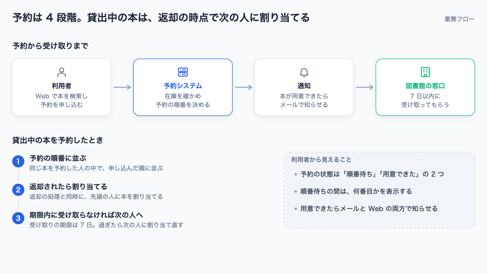
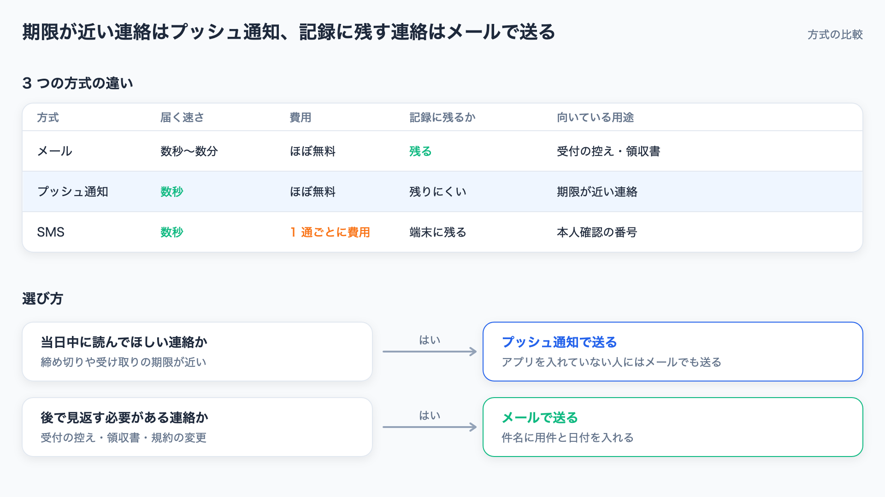

# svg-infographic

業務フロー・比較表・タイムライン・障害の振り返りなどのインフォグラフィックを、スライドに貼れる 1 枚の SVG で作る [Claude Code](https://docs.claude.com/en/docs/claude-code) のスキルです。描いた図は PNG に変換し、文字のはみ出しや重なりを Claude 自身が確認してから渡します。

[English](#english)



| 比較表 | 障害の振り返り |
|---|---|
|  |  |

作例の内容はすべて架空のものです。作例を描くスクリプトは [examples/gen_examples.py](examples/gen_examples.py) にあります。

## 特徴

- **見出しに結論を書く**: 「原因」ではなく「原因：月曜の朝に予約が集中し、CPU が上限に達した」のように、1 枚で伝えることを 1 つに絞ります
- **部品集で描く**: カード・矢印・表・タイムライン・手順・区域の枠・アイコンなどを Python の部品集（[svgparts.py](plugins/svg-infographic/skills/svg-infographic/scripts/svgparts.py)）にまとめています。色・文字の大きさ・太さは部品集の中で揃えてあります
- **描いた後に確かめる**: 部品集は、文字がカードからはみ出しそうなときや矢印が短すぎるときに警告を出します。そのうえで PNG を見て、重なりや余白の偏りを直します
- **比喩を使わない**: 「火消し」「爆速化」のような言い方は、「障害に対応する」「処理時間を 2 分の 1 にする」のように文字どおりの表現に直します
- **日本語の資料向け**: 全角・半角の文字幅を分けて見積もり、日本語の文字が詰まりすぎないようにしています

## 必要なもの

- Claude Code
- Python 3（標準ライブラリだけを使います）
- PNG への変換に使うブラウザ: Google Chrome・Chromium・Microsoft Edge のいずれか
  - 見つからないときは、環境変数 `SVGPARTS_CHROME` にブラウザの実行ファイルのパスを入れてください
- 日本語のフォント: ヒラギノ角ゴシック・游ゴシック・Noto Sans JP のいずれか

## 導入

Claude Code で次の 2 つを実行します。

```
/plugin marketplace add usuginus/svg-infographic
/plugin install svg-infographic@svg-infographic
```

## 使い方

図にしたい内容を渡して頼むだけです。スキル名を指定しなくても、次のような依頼で使われます。

- 「この設計書の処理の流れを図解して」
- 「3 つの案の比較をスライドに貼れる図にして」
- 「障害の経緯と再発防止策を 1 枚のインフォグラフィックにまとめて」

Claude は、伝えることを決める → 構成を選ぶ → 部品集で SVG を書く → PNG にして確認する、の順に進めます。最後に SVG と PNG の場所を伝えます。

部品集は、スキルを使わずに直接使うこともできます。

```python
import sys
sys.path.insert(0, "plugins/svg-infographic/skills/svg-infographic/scripts")
from svgparts import Slide, C

s = Slide("図のタイトル", "図の内容を一文で")
s.header("見出しには結論を書く", "補足")
s.flow(120, [
    ("受け付ける", ["申し込みを受け取る"], None),
    ("確かめる", ["内容を確認する"], C.PRIMARY),
    ("知らせる", ["結果をメールで送る"], C.GREEN),
])
s.save("out.svg")
s.render("out.png")
```

アイコンの一覧は `python3 svgparts.py icons icons.png` で PNG にできます。

## 構成

```
.claude-plugin/marketplace.json          # marketplace の定義
plugins/svg-infographic/
  .claude-plugin/plugin.json             # プラグインの定義
  skills/svg-infographic/
    SKILL.md                             # 手順と表現の規則
    scripts/svgparts.py                  # 部品集
examples/                                # 作例と、作例を描くスクリプト
```

## ライセンス

[MIT](LICENSE)

---

## English

A [Claude Code](https://docs.claude.com/en/docs/claude-code) skill that draws business infographics — process flows, comparison tables, timelines, incident reviews — as a single slide-ready SVG. Claude converts each figure to PNG and checks it for overflowing text and overlaps before handing it over.

The skill's instructions are written in Japanese and tuned for Japanese text, but the parts library also measures half-width characters.

**Requirements**: Claude Code, Python 3 (standard library only), and Google Chrome, Chromium, or Microsoft Edge for PNG conversion (set `SVGPARTS_CHROME` to the browser's executable if it is not found automatically).

**Install**:

```
/plugin marketplace add usuginus/svg-infographic
/plugin install svg-infographic@svg-infographic
```

Then ask Claude to "make an infographic of …" or "draw a flow diagram of …". All examples in this repository are fictional.

License: [MIT](LICENSE)
