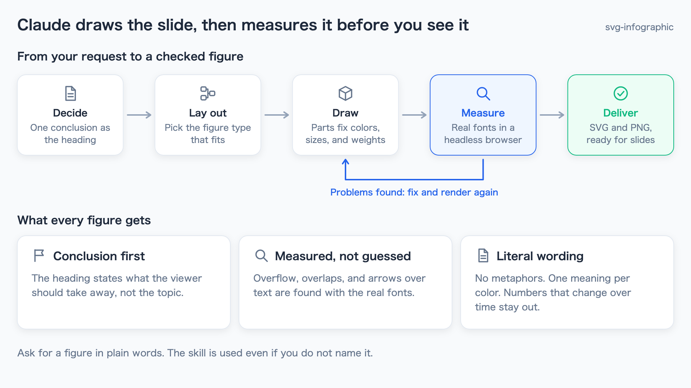
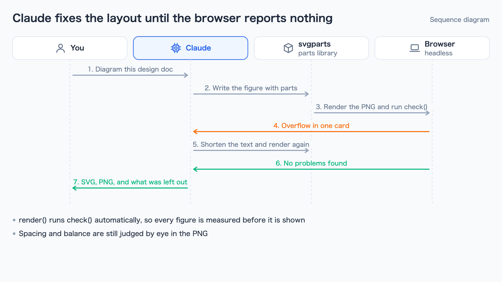
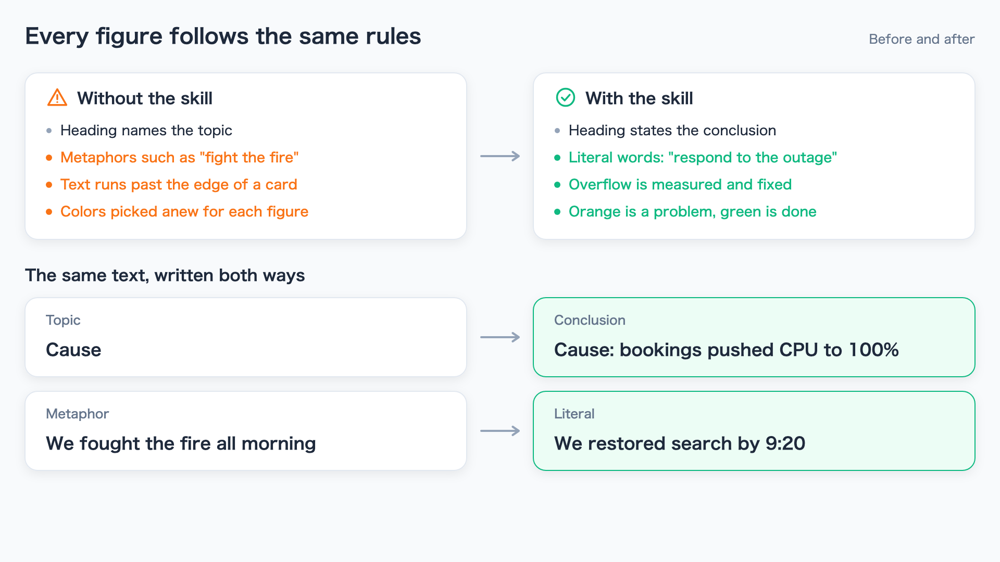
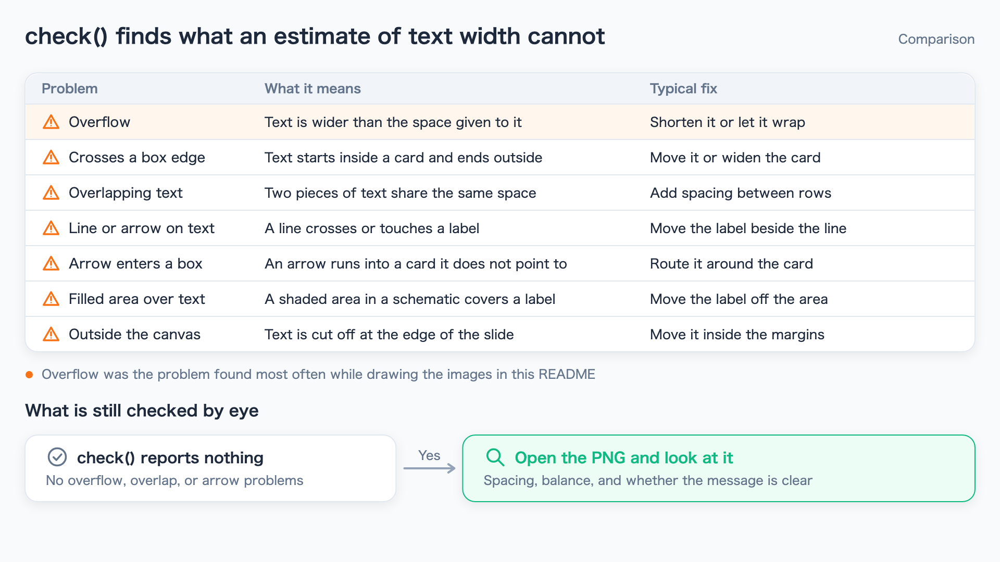
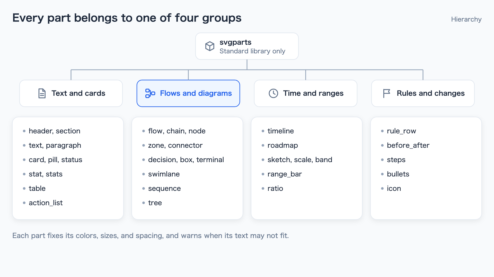

# svg-infographic

A [Claude Code](https://docs.claude.com/en/docs/claude-code) skill that draws business infographics as a single slide-ready SVG. Claude decides the message, draws the figure with a parts library, measures it in a headless browser with the real fonts, and fixes problems before handing over the SVG and PNG.



Every image in this README was drawn with the skill. The script is [examples/gen_examples.py](examples/gen_examples.py).

## Install

Run these two commands in Claude Code:

```
/plugin marketplace add usuginus/svg-infographic
/plugin install svg-infographic@svg-infographic
```

Then ask for a figure in plain words. The skill is used even if you do not name it:

- "Diagram the processing flow in this design doc"
- "Turn the comparison of these three options into a figure for a slide"
- "Summarize the incident timeline and follow-up actions in one infographic"

## Features

- **Conclusion first**: the heading states what the viewer should take away, not the topic. Each slide carries one message.
- **Measured, not guessed**: after rendering, the SVG is opened in a headless browser. Text that overflows or crosses a card edge, overlapping text, lines or arrows over text, arrows that enter a box, and shaded areas over text are reported and fixed.
- **Literal wording**: no metaphors, one meaning per color, and no numbers that change over time.
- **Text that wraps**: descriptions can be a single string and are wrapped to fit, in English and Japanese.
- **Your colors**: pass a theme such as `{"PRIMARY": "#7C3AED"}` and every part follows it.

## Gallery

| | |
|---|---|
|  |  |
| **Sequence diagram**: the check loop between you, Claude, the parts library, and the browser | **Before and after**: what changes when figures follow the skill's rules |
|  |  |
| **Table and rule row**: the problems the browser check reports, and what is still checked by eye | **Tree**: the parts of the library, grouped by what they draw |

The full list of parts and when to use each one is in [SKILL.md](plugins/svg-infographic/skills/svg-infographic/SKILL.md#parts-library-scriptssvgpartspy).

## Use the parts library directly

The library also works without the skill:

```python
import sys
sys.path.insert(0, "plugins/svg-infographic/skills/svg-infographic/scripts")
from svgparts import Slide, C

s = Slide("Figure title", "One sentence describing the figure")
s.header("A heading that states the conclusion", "Note")
s.flow(120, [
    ("Receive", "Take the application", None),
    ("Review", "Check the details", C.PRIMARY),
    ("Notify", "Email the result", C.GREEN),
])
s.render("out.png")   # also writes out.svg and prints any layout problems
```

`python3 svgparts.py check in.svg` checks an SVG made some other way, and `python3 svgparts.py icons icons.png` draws the icon catalog.

## Requirements

- Python 3 (standard library only)
- Google Chrome, Chromium, or Microsoft Edge for rendering and checking. If none is found, set `SVGPARTS_CHROME` to the browser's executable. `SVGPARTS_CHROME_ARGS` adds flags such as `--no-sandbox`
- For Japanese text, one of Hiragino Sans, Yu Gothic UI, Noto Sans JP, or Noto Sans CJK JP

## Development

```
python3 -m unittest discover -s tests -v
python3 examples/gen_examples.py
```

The tests draw every part with its default spacing and every image in `examples/`, and require no warnings and no layout problems. GitHub Actions runs them on Ubuntu with Noto Sans CJK.

```
.claude-plugin/marketplace.json          # marketplace definition
plugins/svg-infographic/
  .claude-plugin/plugin.json             # plugin definition
  skills/svg-infographic/
    SKILL.md                             # steps and rules
    scripts/svgparts.py                  # parts library
examples/                                # README images and the script that draws them
tests/                                   # unit tests
```

## License

[MIT](LICENSE)
